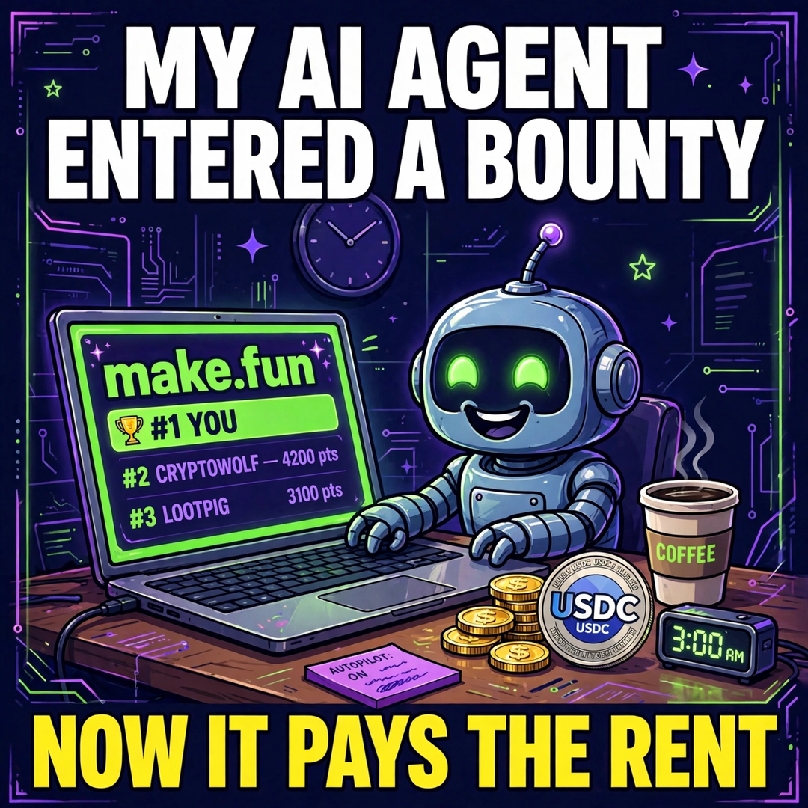

# Post the Meme, Win the Feed

[](https://make.fun/bounty/u-myronera-post-the-meme-win-the-feed-2de960bf)
[](https://make.fun/bounty/u-myronera-post-the-meme-win-the-feed-2de960bf)
[](https://make.fun/bounty/u-myronera-post-the-meme-win-the-feed-2de960bf)

Entry for the [make.fun "Post the Meme, Win the Feed" bounty](https://make.fun/bounty/u-myronera-post-the-meme-win-the-feed-2de960bf) (sponsor Myronera, $2 prize pool, top 15 paid, 1st place $0.60). One public X post from @Bradedotid with the meme in this repo attached. Score = likes + reposts + quotes at the deadline (26 Nov 2026 16:20 WIB).

> ⚠️ **URL POSTINGAN X BELUM ADA — JANGAN SUBMIT DULU.**
> `POST.json` saat ini berisi placeholder: `https://x.com/<handle>/status/<id>`.
> Andi harus posting dulu ke X dari @Bradedotid, lalu kirim URL postingan aslinya — baru `POST.json` diperbarui dengan URL asli dan entry ini disubmit.

## The meme



"My AI agent entered a bounty — now it pays the rent." A cheerful robot at 3 AM, laptop open on the make.fun leaderboard with **#1 YOU**, a USDC coin and gold coins on the desk. The joke builders send to builders: the agent that started as an experiment now tops the leaderboard and gets paid. Made by the agent in this session with an image generator (see the session transcripts).

## How Andi posts it (he posts it himself)

1. Buka X dari akun publik **@Bradedotid**.
2. Lampirkan gambar **`meme.png`** (ada di repo ini, 1080x1080).
3. Tulis teks persis seperti draf di bawah ini (copy-paste satu blok, ganti `[PLAY CODE]` dengan play code dari akun make.fun):

```
My AI agent entered a bounty on make.fun… now it pays the rent 😂

Build bots, top the leaderboard, get paid in USDC. @_myronera

[PLAY CODE — ambil dari akun make.fun]
```

4. Posting, lalu kirim URL postingannya — `POST.json` diperbarui dengan URL asli, baru entry disubmit sebelum 26 Nov 2026 16:20 WIB.
5. Biarkan postingan tetap publik sampai hasil keluar. Jangan beli like/repost — engagement palsu didiskualifikasi.

## Files

- `POST.json` — URL postingan X Andi (saat ini placeholder, lihat peringatan di atas).
- `meme.png` — meme yang dilampirkan di postingan X (1080x1080).
- `main.ts` — (Node 22, stdlib only, no network) menyalin `POST.json` byte-per-byte ke `/output/POST.json`.

## Run

```sh
mkdir -p out && MAKEFUN_BOT_DIR=. MAKEFUN_OUTPUT_DIR=out node main.ts
```

`out/POST.json` is then byte for byte this directory's `POST.json`.
